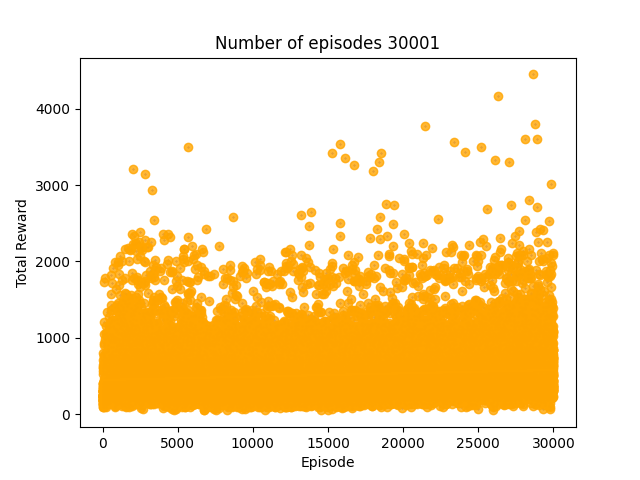
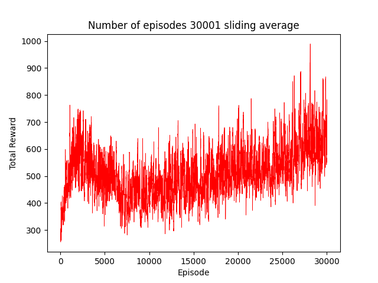
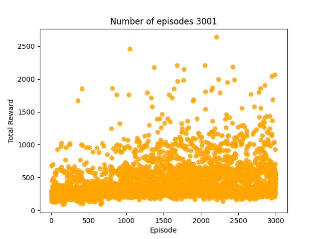
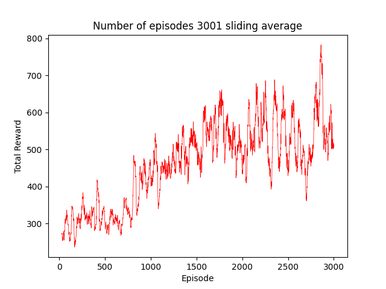

# RL-PacMan

Deep Q-learning and REINFORCE agents that learn to play Ms. Pac-Man from pixel observations in Gymnasium, using PyTorch. Part of my bachelor's thesis on reinforcement learning.

Both agents play `ALE/MsPacman-v5`. Each frame is cropped, downsampled, and normalized, then passed to a small convolutional network. The action space is the first five ALE actions.

## Repository layout

| File | What it is |
| --- | --- |
| `pacman_QLEARNING_lastversion.ipynb` | DQN agent, replay memory, and training loop |
| `pacman_REINFORCE_lastversion.ipynb` | REINFORCE agent and training loop |
| `dqn_episode_30000.pth`, `dqn_episode_30750.pth` | Saved DQN weights |
| `reinforce_episode_3000.pth` | Saved REINFORCE weights |
| `total_reward_qlearning_.png`, `sliding_average_reward_qlearning.png` | DQN training curves |
| `total_reward_reinforce_.png`, `sliding_average_reward_reinforce.png` | REINFORCE training curves |

## Setup

Python 3.11.

```bash
python -m venv .venv
source .venv/bin/activate
pip install -r requirements.txt
```

`gymnasium[atari,accept-rom-license]` installs the Arcade Learning Environment and accepts the ROM license so `ALE/MsPacman-v5` can load. The Q-learning notebook places the network on Apple MPS, so that notebook needs a Mac with Metal. The REINFORCE notebook uses MPS when it is available and CPU otherwise.

## Running

Open a notebook and run the definition cells from top to bottom. The `if __name__ == "__main__"` cell does not run inside Jupyter. Call the function yourself.

Create the output folder before a training run. The notebooks save checkpoints and plots there every 50 and 100 episodes.

```bash
mkdir -p pth_de_pacman_50000
```

```python
pacman_train()   # 30001 episodes
pacman_play()    # render one game
```

`pacman_play()` loads `pth_de_pacman_30000/dqn_episode_30000.pth`. The checkpoint in this repository is `dqn_episode_30000.pth` at the root.

```bash
mkdir -p pth_de_pacman_reinforce_multinomial_eps01
```

```python
pacman_train()   # 10001 episodes
pacman_play()    # render one game
```

`pacman_play()` loads `agent.pth`. The checkpoint in this repository is `reinforce_episode_3000.pth`.

## Training setup

Shared reward shaping, applied to the signal the agent learns from. The logged score is still the raw game reward.

- Lose a life: −50
- Same reward as the previous step: −1
- Reward above 10: clipped to 10

| | DQN | REINFORCE |
| --- | --- | --- |
| Episodes | 30001 | 10001 |
| Discount | 0.999 | 0.99 |
| Learning rate | 1e-4 | 1e-4 |
| Exploration | ε from 0.9 to 0.1, decay 700000 | ε from 0.7 to 0.1, plus softmax temperature 1.5 |
| Update | Every 30 steps, replay batch of 128, MSE | Every 25 steps, entropy bonus 0.001 |

## Results

DQN, reward per episode and a 30-episode sliding average:




REINFORCE, reward per episode and a 30-episode sliding average:




## License

MIT. See [LICENSE](LICENSE).
